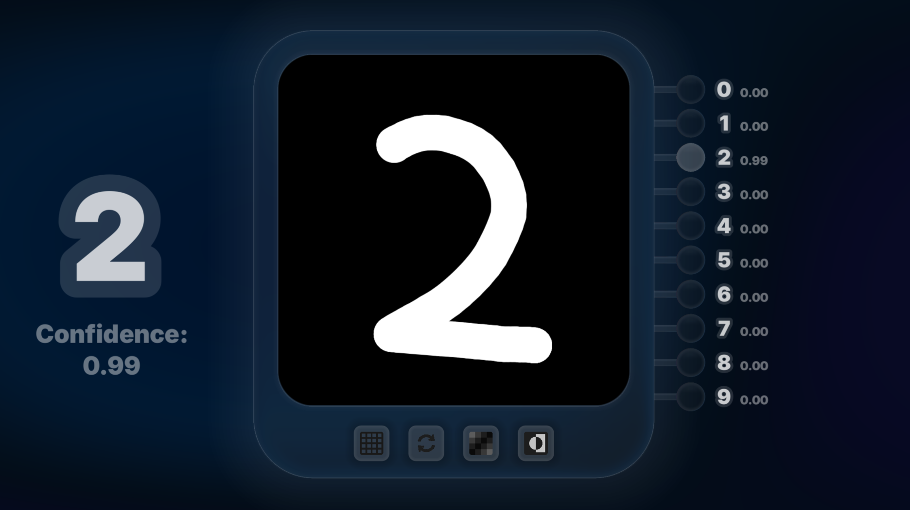

# **AI DIGIT RECOGNIZER**
#### **Video Demo:**  https://www.youtube.com/watch?v=-n1uytGfoBQ
#### **Github repo:** https://github.com/ADOGamedev/AI-Digit-Recognizer
#### **Description:** This is an application made in Godot 4.6 and C++ through GDExtensions[^1]; it consists of a canvas with some buttons in which you can draw. As you draw, a Neural Network written in C++ will try to predict what digit is currently drawn.

## **GODOT UI**


This is the thing you'll see: everything related to the user interface and image pre-processing happens in the `project/` folder.
The Godot scenes are in `project/scenes/`, the GDScript source code is in `project/src/`, and all the images, fonts, and Godot themes are in `project/assets/`.

> [!NOTE]
> The `project/bin/` folder stores the `.gdextension` and `.dll` files that make C++ work in Godot.[^1]

### **Scenes**

- **`main.tscn`**: this is, well, the main scene. It just has an instance of other scenes to put it all together; it also has a background `ColorRect`, which has a subtle animation with colors changing between different shades of blue and purple.

- **`paint_widget.tscn`**: although not the main scene, it is the most important part. This scene handles drawing, the compression, and the pre-processing of the drawn image before passing it to the neural network.

- **`controller_button.tscn`**: this is a customized button that has a liquid glass style and smooth animations.

- **`paint_widget_controller.tscn`**: this scene just mixes four controller buttons, the paint widget, and decorates them with a liquid-glass-styled panel.

- **`output_neurons.tscn`**: this consists of two liquid-glass-styled panels and two labels with a translucent style.
The panels imitate a "neuron", a line connected to a circle which can be more or less activated, that is controlled through a shader which tints it white depending on the value. One of the labels just indicates what number the neuron corresponds to, and the smaller one indicates the confidence of that number being the one you drew.

- **`output_vector.tscn`**: this is just ten output neurons in a column, each with its corresponding digit, which indicates the full output vector of the neural network.

- **`big_digit_value_pair.tscn`**: this is a bigger version of that digit-confidence pair each output neuron has, used to display the digit the network guessed.

> [!WARNING]
> Most of the shaders are generated with AI (I don't know how to write them yet), as well as some parts of the GDScript or C++ code. Used AIs: Claude and ChatGPT. Though I have some intuition on how each AI-generated part works.

### **GDScript Code**

> [!NOTE]
> Each script is found inside a folder with the same name as the scene it is associated with, except for `global.gd`, `main.gdshader`, and `logo.gdshader`.

- **`paint_widget.gd`**: this is the most important one, it handles image resizing, input detection, and drawing, among its properties we have:
    - **`image`, `compressed_image`, `centered_image`, `brush_overlay_image`**: they are images that store the drawn image, the downsized image, a centered version of the image, and an image that just shows the brush, respectively.

        > `brush_overlay_image` is an `Image` instead of being drawn in the Godot `_draw()` function, because then I can apply a shader to round corners.
    
    - **`_image_dirty`, `_overlay_dirty`, `_centered_image_dirty`**: these are some boolean flags to update the images just when necessary. So if nothing new is drawn, it won't be updated.

    And these are the most important functions:

    - **`_process(delta)`**: this is the main loop, it calls `handle_input()` and other functions to update when neccesary.

    - **`handle_input()`**: it detects mouse inputs and calls `draw_capsule(...)` by getting the current mouse position and the previous one.

    - **`draw_capsule(...)`**: it calculates the distance to the segment joining pos1 and pos2 for each point, and if it's closer than the brush radius, it colors that point with the corresponding color.

    - **`update_centered_image()`**: it calculates the centroid of the image by looking at the colored pixels, then it centers the drawing. Next, it calculates the target size of the image so that it is contained within some margins of the full image. Finally, it resizes and merges the new centered image, after which it updates the array that will be passed into the neural network.

- **`global.gd`**: just a script that every other can access, which stores the input and output of the neural network.

- **`controller_button.gd`**: this is a (not so well-written) script that detects when the mouse interacts with the button to animate the button smoothly, using the Godot `Tween`.

- **`paint_widget_controller.gd`**: simple script, detects when each button is pressed and calls the corresponding function of `PaintWidget`.

- **`output_neuron.gd`**: also a simple script, it updates the neuron and label so that it shows the current value.

- **`output_vector.gd`**: just updates the ten neurons with the output values of the neural network.

- **`big_digit_value_pair.gd`**: gets the guessed digit and updates the labels accordingly.

### **GDSL (Godot Shading Language) scripts**

- **`main.gdshader`**: it gives the effect of a smooth animation with varying colors, used in the background of the app.

- **`output_neuron/neuron_shader.gdshader`**: it rounds the neuron and tints it white below a certain threshold, the value of the output neuron.

- **`paint_widget/rounded_paint_widget.gdshader`**: it rounds the paint widget so that it looks nice when placed inside `PaintWidgetController`.

- **`paint_widget_controller/liquid_glass.gdshader`**: shader by sentinelcmd, https://godotshaders.com/shader/liquid-glass-ui-customizable/.
It makes a `ColorRect` have the Apple liquid glass style.


### **C++ code**

This is the actual logic of the neural network, stored in the `src/` folder.
> [!NOTE]
> I decided to do the network in C++ as I can better understand the underlying details, and as I have already done other stuff with Godot + C++, it was better for me.

- **`main/main.cpp` and `main/main.h`**: this is a `Main` class, which is the Godot Extension that communicates with the GDScript code via `Global`, it also creates the `NeuralNetwork`. Moreover, in `main/main.h`, there is defined a `GodotLogger` which relates to the `logger/Logger` code.

    I also used this file for the process of training (the number of batches is an overkill; I didn't know how many I needed). This managed to train the network up to somewhat more than 98% accuracy in the MNIST Dataset[^4]:
    ```c++
    int main() {
        Logger::Logger logger = Logger::Logger();
        Logger::set_logger(&logger);

        MNISTDataset::load_data();

        NeuralNetwork neural_net;
        neural_net.load_from_json("...\\src\\neural_network\\neural_network.json");

        Trainer trainer(&neural_net, 2.0);
        trainer.train(1000);
        trainer.set_learning_rate(0.5);
        trainer.train(2000);
        trainer.set_learning_rate(0.1);
        trainer.train(2000);

        neural_net.save_to_json("...\\src\\neural_network\\second_attemp\\trained_network2.json");
    }
    ```

- **`logger/Logger.cpp` and `logger/Logger.h`**: this allows me to set a `Logger` which uses `std::cout` or `godot::UtilityFunctions::print()` to print out in the terminal or Godot terminal.

- **`neural_network/NeuralNetwork.cpp` and `neural_network/NeuralNetwork.h`**: the most important one, it contains a `Layer` struct, a `WeightMatrix` struct, and the `NeuralNetwork` class. This last one is responsible for loading and saving the network to a JSON file and doing the forward pass to compute the output. The other structs are just to abstract some bit of code and make it easier to work with collections of vectors and matrices.

- **`register_types/register_types.cpp`and `register_types/register_types.h`**: GDExtension[^1] specific stuff, to register the `Main` class.

- **`thirdparty/eigen-5.0.0`**: the Eigen[^2] library to do linear algebra in C++.

- **`thirdparty/nlohmann`**: a C++ library to work with JSON[^3] files.

- **`utils/utils.h`**: a randf function, to initialize the network randomly, and an AI-Generated function that just gets the `.exe` path to access `final_trained_network.json` in `main.cpp`.

> [!WARNING]
> The following code could be deleted as the neural network is already trained.


- **`trainer/Trainer.cpp` and `trainer/Trainer.h`**: it does the backpropagation algorithm using Stochastic gradient descent[^5] with mini-batches, updating the weights and biases of the network according to the learning rate.

- **`thirdparty/mnist-loader`**: some code I found in this Github repo: https://github.com/arpaka/mnist-loader
which just facilitates the reading of the MNSIT[^4] binary files.

- **`mnist_dataset/`**: stores the binary files of the famous MNIST Dataset[^4] used to train the network. It also contains `MNISTLoader.h`, which defines a namespace in which the train and test examples are stored using the struct `MNISTImageLabel`; it also has some functions to read the dataset using `mnist-loader` and adapt it to my format.

- **`tests/sigmoids_benchmark`**: a benchmark I found here:
https://gist.github.com/astanin/5270668
which compares different non-linear activation functions for the neural network. I also extended it using AI to compare the activation function when applied to a vector.

### **Neural Network JSON saving**

The way I chose to store the neural network is via JSON files with the following structure:

```json
{
    "biases": [
        [/*biases of layer 1*/],
        [/*biases of layer 2*/],
        [/*biases of layer ...*/]
    ],
    "inputs": 784,
    "weights": [
        // Weights matrix 1
        [
            [],
            [],
            []
        ],
        // Weights matrix 2
        [
            [],
            [],
            []
        ],
        // Weights matrix ...
        [
            [],
            [],
            []
        ]
    ]
}
```

[^1]: https://docs.godotengine.org/en/4.4/tutorials/scripting/gdextension/gdextension_cpp_example.html
[^2]: https://libeigen.gitlab.io/
[^3]: https://github.com/nlohmann/json
[^4]: https://www.kaggle.com/datasets/hojjatk/mnist-dataset
[^5]: https://www.youtube.com/watch?v=aircAruvnKk&list=PLZHQObOWTQDNU6R1_67000Dx_ZCJB-3pi  
http://neuralnetworksanddeeplearning.com/


